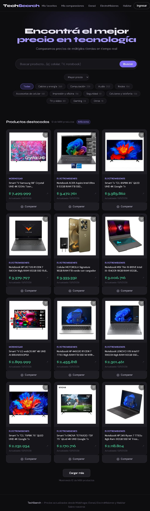
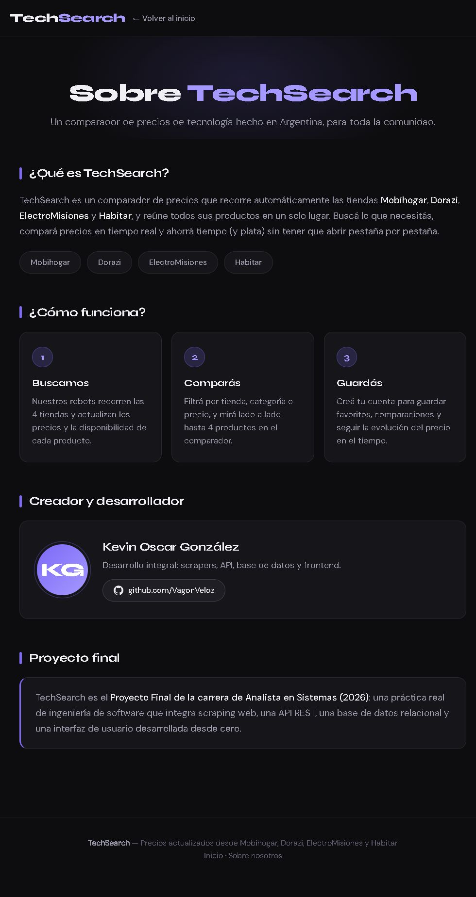

# Hola, soy Kevin Oscar González 👋

## 🚀 TechSearch — Proyecto Final

**Comparador de precios de tecnología** que recorre en tiempo real las tiendas argentinas **Mobihogar, Dorazi, ElectroMisiones y Habitar**, y reúne todos sus productos en un solo lugar.

### Características
- 🔍 **Búsqueda y filtros** por tienda, categoría y precio (con paginación "Cargar más").
- ⚖️ **Comparador** de hasta 4 productos lado a lado.
- ❤️ **Favoritos y comparaciones guardadas** con cuenta de usuario.
- 📈 **Historial de precios** con gráfico de evolución por producto.
- 🔐 **Autenticación segura**: contraseñas con scrypt, tokens de sesión hasheados, límite de intentos y reset por mail.
- 🖼️ **Imágenes localizadas** en el servidor para carga rápida.

### Stack tecnológico
| Capa | Tecnologías |
|---|---|
| Scraping | Python, BeautifulSoup, Requests |
| Backend | Flask, flask-cors (API REST) |
| Base de datos | MySQL / MariaDB |
| Frontend | HTML, CSS y JavaScript puro (sin frameworks) |
| Seguridad | Rate limiting, tokens hasheados, política de contraseñas |

---

## 🛠️ Lo que hago

- **Scraping y automatización** — extracción robusta de datos de sitios web con protección contra páginas caídas, pausas y validación de enlaces.
- **APIs REST** — endpoints con autenticación por token, paginación y CORS configurable.
- **Bases de datos** — modelado relacional, migraciones e integridad referencial.
- **Frontend** — interfaces responsive con tema oscuro, escritas a mano con HTML/CSS/JS.

---

## 📫 Contacto

- **GitHub:** [github.com/VagonVeloz](https://github.com/VagonVeloz)

> 💡 El código fuente de TechSearch está disponible bajo solicitud.
